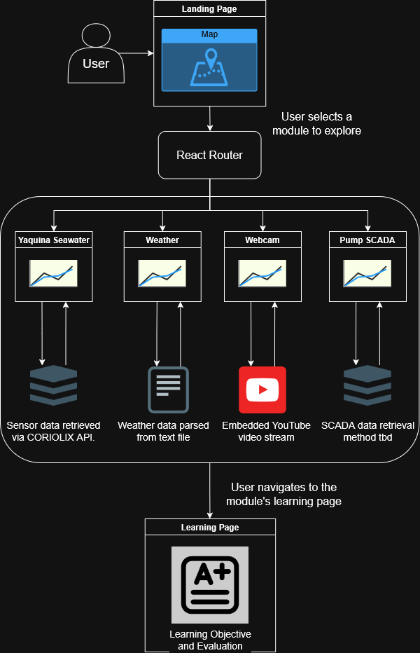

# Design Doc: Hatfield Live Data Public UI

## Overview

An education and exploration-focused web app for the Hatfield Marine Science Center, showcasing a variety of data streams collected at the center as well as additional educational information about the HMSC and Yaquina estuary. UI is built in React, consisting of an interactive map containing modules for different data streams, each collected from their respective APIs or alternative sources. The app is targeted toward people ages 8 and up, with the goal of informing people about the HMSC and Yaquina Estuary, and allowing them to explore the relationships between different pieces of data, e.g. water depth and salinity.

## Architecture

- Web App (React, Tailwind): The main landing page featuring the map, and individual modules containing data streams and other information.
- Routing (React-Router-Dom): Navigation to landing page and modules.
  

## Interfaces

### Modules

The content of the site is divided into modules, each focused on a different live data stream or area of interest at the HMSC, and each with a learning outcome based around its content. Users will interact with modules by viewing the data or information presented on the 'data page' and evaluating the learning outcomes by responding to questions on the 'learning page' of the module.

### Routing: 

React Router uses BrowserRouter to route between each module from the home, e.g. /seawater or /weather. The home page features an interactive map of the HMSC, and links to each module will be placed as buttons whose location on the map corresponds to their real-life location at Hatfield. Clicking these links will allow users to navigate to the corresponding module.

### Data Visualizations: 

Data received from each module's live data source will be translated and visualized according to the format and learning outcomes of that module, rather than being presented as raw data. For example, weather data will be formatted into a readable table and water quality parameters will be formatted into a time series chart.

## Data Model

Different data streams are accessed through different methods, and in different formats.

- CORIOLIX API: [Dock-mounted sensor](https://hmsc-cms.dri.oregonstate.edu/sensor/info/ysiexo102132/) which records seawater parameters at 15-minute intervals. Data is retrieved through the [CORIOLIX API](https://hmsc-cms.dri.oregonstate.edu/api/decimateData/?model=SensorMixLg3&last_item=1&format=json) as a list of entries whose corresponding parameters are listed [here](https://hmsc-cms.dri.oregonstate.edu/parameter/list/short_name/sensor_id/). json data containing sensor readings over a given time period.
  - The desired parameters (depth and salinity) will be retrieved from the API response and transformed into a time series chart, allowing users to view the change in their levels over a given time period (likely 24h).
- Pumped Water SCADA: retrieval method and format TBD
- Underwater/Bay Webcams: Embedded live YouTube video stream.
  - This data will undergo no transformation, as the live video stream can be directly embedded and viewed in its existing format.
- Weather Station Data: We do not have access to the data on the CEOAS servers, but the data is available via a text file which updates at regular intervals, we will access the data by retrieving and parsing that file.
  - Data will be transformed into averages over different periods of time (day, week month) and time series visualizations of the data over time.

In case of a live data source being broken, down for maintenance, or otherwise inaccessible, the status will be reported within the module, and sample data may be stored used as a placeholder to preserve the learning outcomes (e.g. previous weather data or water quality measurements).

## Deployment Shape

- The hosting location is currently undecided, and options are being researched by the development team and project partner.
- Deployment of the site will initially be done via GitHub Pages, and we will work with IT to determine the necessary steps and location for permanent deployment with a subdomain of the HMSC site.

## Open Questions

- How will SCADA and weather station data be accessed?
- What library/package will be used for charts/visualization?

## Deferred Decisions

- Where will the site be hosted (CEOAS, HMSC Library, OSU CS Servers, etc)
