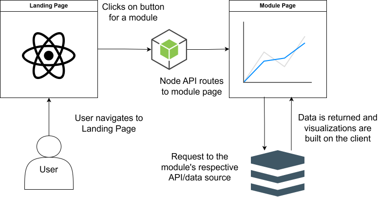

# Repo Checkpoint 1

Project 23: Hatfield Live Data Public UI

Levi Cook <cooklev@oregonstate.edu>, Alexander Jiang <jiangal@oregonstate.edu>, Logan Jordan <jordanlo@oregonstate.edu>, John Paul Igloria <igloriaj@oregonstate.edu>


# Repository URL

https://github.com/LoganJordan04/hatfield-live-data-public-ui


# Commit to grade

https://github.com/LoganJordan04/hatfield-live-data-public-ui/commit/e78489c78110d63d41b39949da45c49581f96291

Hash: e78489c


# Milestones

## CI
Currently there is a basic CI in place in .github/workflows/ci.yml and a failure can be seen here https://github.com/LoganJordan04/hatfield-live-data-public-ui/pull/22

## Board
https://github.com/users/LoganJordan04/projects/2/views/1
Currently our board shows the backlog of what we completed/set up for this repo checkpoint assignment. In the future this milestone will be kept up to date by the entire team as we begin development and assigning more strict roles.

## Production Target
Our walking skeleton lives in /src/App.tsx and main.tsx here our code can be deployed using npm run dev to view the code working locally. Currently we do not have a working or planned URL so for now it will need to be run locally. We need to discuss more in depth with our project parter how the web app will be deployed and we plan to have this done by the end of Fall Term. As a team we agree that deployed in fall will look like having a landing page containing buttons that lead to a new page that displays the appropriate data stream. We are more focused on functionality this term then style/UI.

## Approval
Risks 1 and 2 in risks.md both state that we are needing information from our project partner and other outside sources. As of 10/30/26 we have reached out to both parties and are waiting on their replies before moving forward the code for the weather station and pumped seawater data streams. These risks are owned by Logan and Levi respectively.

## Inherited Code Base Audit
N/A, since we are starting this project from scratch. Any APIs we will be using, we will not have access to the code/have the ability to change anything about it.


# Requirements

## Problem statement

The Hatfield Marine Science Center hosts four live data streams on various servers and websites: (Weather Station, Yaquina Water Quality, Pumped Seawater SCADA, OSU underwater dock webcam). Part of Hatfield's mission is to make marine science accessible and relevant to the general public. Currently, the four data streams are scattered about, making it hard and inconvenient to see the data that each server/website hosts. Visitors to the HMSC also don't typically see this data, so it would be nice to consolidate the data in one place as part of an exhibit. Creating a user friendly website that displays all four data streams in one place will make it easier for people to access/see all of that data, and it will encourage visitors to explore and think about how the data streams might be related. 


## Functional requirements

- FR-1 (Must: it is part of the UI that our displayed data streams will be accessed and built from): A user sees a graphic map of the Hatfield Marine Science Center when they first access the website. Acceptance: The map is visible on the website.


## Non-functional requirements

- NFR-1 (Should: it is frustrating to use a slow website): The website and its elements loads in under 2 seconds on any Wi-Fi network.


## Constraints

- C-1: The map of the Hatfield Marine Science Center comes from our project partner, Marnie Zirbel.


## Success metrics

- SM-1: All data streams showcased on website: 4 data streams (data gathered from websites and/or API).

- SM-2: Users that use the website meet the learning outcomes: All learning outcomes met for the respective modules/data streams (learning outcomes come from Marnie Zirbel's Box files).

- SM-3: Users that use the website in general: Users are engaged and easily able to see the data from the 4 data streams (Conduct surveys with general public and visitors at the HMSC to gather responses and reactions to the website).


## Non-goals

- NG-1: The tech stack we are using.

- NG-2: Creating a mobile app in addition to a website.


## Open questions

- OQ-1: How do we access the Pumped Seawater SCADA data stream, through a website or API? Owner: Logan Jordan, we've already asked our project partner about it and are hoping to get access to it by the end of fall term.

- OQ-2: Is there a public API for the Weather Station data stream, or will we have to web scrape the data? Owner: Levi Cook, we've already reached out to our project partner and another person in charge of that data stream, and we are hoping for an answer by the end of fall term.


# Design Doc: Hatfield Live Data Public UI

## Overview

An education and exploration-focused web app for the Hatfield Marine Science Center, showcasing a variety of data streams collected at the center as well as additional educational information about the HMSC and Yaquina estuary. UI is built in React, consisting of an interactive map containing modules for different data streams, each collected from their respective APIs or alternative sources. The app is targeted toward people ages 8 and up, with the goal of informing people about the HMSC and Yaquina Estuary, and allowing them to explore the relationships between different pieces of data, e.g. water depth and salinity. 


## Architecture

- Web App (React, Tailwind): The main landing page featuring the map, and individual modules containing data streams and other information. 
- API Routes (Node): Navigation to landing page and modules.




## Interfaces

- REST API: routes for each module, e.g. /modules/{module_name}
- Data Visualizations: charts generated using a react-compatible library (HighCharts or ReCharts)


## Data Model

Different data streams are accessed through different methods, and in different formats.
- CORIOLIX API: [Dock-mounted sensor](https://hmsc-cms.dri.oregonstate.edu/sensor/info/ysiexo102132/) which records seawater parameters at 15-minute intervals. Data is retrieved through the [CORIOLIX API](https://hmsc-cms.dri.oregonstate.edu/api/decimateData/?model=SensorMixLg3&last_item=1&format=json) as a list of entries whose corresponding parameters are listed [here](https://hmsc-cms.dri.oregonstate.edu/parameter/list/short_name/sensor_id/). json data containing sensor readings over a given time period.
- Pumped Water SCADA: retrieval method and format TBD
- Underwater/Bay Webcams: Embedded live YouTube video stream.
- Weather Station Data: json data via API if available, or scraped data from existing [html page](https://weather.hmsc.oregonstate.edu/) which updates at 5 minute intervals.


## Deployment Shape

- The hosting location is currently undecided, and options are being researched by the development team and project partner.
- Deployment of the site and its pages is done through the Node API.


## Open Questions

- How will SCADA and weather station data be accessed?
- What library/package will be used for charts/visualization?


## Deferred Decisions

- Where will the site be hosted (CEOAS, HMSC Library, OSU CS Servers, etc)


# Risks

Objective: Create a user friendly web-based UI that showcases all four data streams (Weather Station, Yaquina Water Quality, Pumped Seawater SCADA, OSU underwater dock webcam), with inclusive design that encourages visitors to explore, and invites curiosity about how data streams might be related. Rank: likelihood/impact (H/M/L) and why.

R-1 business, H/H (dealing with this now; it will delay the completion of the project). We currently don't have any website or API access to the Pumped Seawater SCADA data stream from a local facilities server; if we continue to not have access, we will be missing a data stream and hence delaying the project's completion. Asked: Our project partner Marnie Zirbel on 10/30/2026. Owner: Logan Jordan. Accept: Marnie Zirbel has reached out to the team behind the data stream, so for now we just wait for updates. If the trigger fires, then our team will try reaching out to the SCADA team. Trigger: We still don't have access to the data stream's website/API by the end of fall term.

R-2 business, H/M (dealing with this now; it could cause us to do unnecessary work). We currently are deciding whether to web scrape the data (harder) from the Weather Station data stream or if to use the API (easier) if there is one; until we know if there is a public API we can use, work on this data stream may have to wait. Asked: Our project partner Marnie Zirbel on 10/30/2026, and the Weather Station lead Craig Risien on 11/1/2026. Owner: Levi Cook. Accept: Alexander Jiang has reached out to Craig Risien, so we will wait for a response on whether or not there is a public API available. If the trigger files, then we will web scrape the data from the Weather Station website. Trigger: We have not received a response from Craig or we find out there is no public API available by the end of fall term.  

R-3 technical, M/M (not all of us are familiar with the tech stack we're going with; it could slow our progress and code output). The team is not all super experienced and versed with the tech stack (React, Vite, etc.), and we do not have a marine science background, making the project a learning curve and new experience for all of us; if we spend too long doing research and experimenting then the project's completion could get delayed. Owner: Alexander Jiang. Mitigate: We will spend most of fall term doing research for the project and learning the tech stack, so by winter term we will be ready to dedicate our time on coding the website fully. Trigger: The team is still spending a majority of the time doing research and learning the tech stack in winter term, rather than coding features that contribute towards the project.

R-4 team, M/L (all of us are busy college students; there is a lot of time to complete the project). The team consists of busy college students, and we may not all be able to dedicate 9 hours of work per week due to other commitments and studying for other classes; if we are all constantly busy doing other things the project could get delayed or we may have to rush things. Owner: JP Igloria. Mitigate: We will try to dedicate time during the week to work on the project, we have a lot of time to complete it so even during slow weeks, we shouldn't fall too far behind. Trigger: The team is not making as much progress as the canvas assignments suggest or require. 


## Closed

No risks currently closed.


# README.md

# Hatfield Live Data Public UI

A public-facing project for bringing Hatfield Marine Science Center's live data into one welcoming place. The goal is to help visitors explore the streams, learn what the readings mean, and wonder how they might be connected.

The experience is being designed for curious visitors ages 8 and up. It should use plain language and be accessible.

_Screenshot will go here._

<!-- Add a screenshot or concept image at `docs/images/project-preview.png`, then uncomment this line. -->
<!--  -->

## Data streams

- Weather station
- Yaquina water quality
- Pumped seawater
- Underwater dock webcam

## Run locally

You will need [Node.js](https://nodejs.org/) and npm.

```bash
npm install
npm run dev
```

Vite will print a local address to open in your browser.

To build and preview the production version locally:

```bash
npm run build
npm run preview
```

## Useful commands

```bash
npm run lint        # Check code style and accessibility rules
npm run typecheck   # Check TypeScript types
npm run build       # Create a production build
npm run preview     # Preview the production build locally
```

## Team

- Levi Cook: [cooklev@oregonstate.edu](mailto:cooklev@oregonstate.edu)
- Alexander Jiang: [jiangal@oregonstate.edu](mailto:jiangal@oregonstate.edu)
- Logan Jordan: [jordanlo@oregonstate.edu](mailto:jordanlo@oregonstate.edu)
- John Paul Igloria: [igloriaj@oregonstate.edu](mailto:igloriaj@oregonstate.edu)

## Contributing

Contributions are welcome. Please see [CONTRIBUTING.md](CONTRIBUTING.md) for setup and contribution guidelines.

## License

TBD


# CONTRIBUTING.md

# Contributing Guide

How to set up, code, test, review, and release so contributions meet our Definition of Done.

This project is the Hatfield Live Data Public UI, a web app that shows four live data streams from the Hatfield Marine Science Center (weather station, Yaquina water quality, pumped seawater, and the underwater dock webcam). The UI must be friendly to people age 8 and up, and the code must be modular and easy to hand off.

## Code of Conduct

We follow the [Contributor Covenant 2.1](https://www.contributor-covenant.org/version/2/1/code_of_conduct/). Be respectful, assume good intent, and give feedback on the work, not the person.

Report conduct concerns to [Logan Jordan](mailto:jordanlo@oregonstate.edu).

## Getting Started

**Prerequisites**

- Git
- Node.js
- npm (ships with Node)

**Setup**

```bash
git clone https://github.com/LoganJordan04/hatfield-live-data-public-ui.git
cd hatfield-live-data-public-ui
npm run dev
```

The app runs at the local URL Vite prints in the terminal.

**Commands**

| Command           | What it does                       |
| ----------------- | ---------------------------------- |
| `npm run dev`     | Start the dev server               |
| `npm run build`   | Create a production build          |
| `npm run preview` | Serve the production build locally |

No environment file is currently required for the app. If configuration is added, document the required variable names and safe local setup here; never put secrets in client-side `VITE_` variables.

## Branching & Workflow

- **Model:** GitHub Flow. `main` is the default branch and is always releasable.
- **Pull request target:** `main` (the CI workflow runs for pull requests targeting `main`).
- **Branch names:** Use a short descriptive name, such as `feature/weather-card` or `docs/contributing-guide`.
- **Keep branches focused** and update them from `main` as needed.
- **Merge method and branch protection:** Follow the options enabled in the GitHub repository; these settings are not defined in the checked-in files.

## Issues & Planning

- Track work in GitHub Issues when an issue is useful. No issue form or issue template is currently checked in.
- Describe the problem or goal, relevant context, and how to tell the work is complete. Link the issue from the pull request when applicable.

## Commit Messages

Keep them short and clear.

- Write a summary in the imperative mood, under 72 characters.
- A prefix is optional. If you use one, pick from `feat`, `fix`, `docs`, `chore`.
- Add a body only when the reason for the change is not obvious from the diff.
- Reference issues in the PR description with `Closes #12` or `Refs #12`.

Examples:

```
Add wind speed card to weather panel
fix: handle empty response from water quality API
docs: add setup steps for .env
```

## Code Style, Linting & Formatting

- **Linter:** ESLint with `typescript-eslint`, the React Hooks plugin, and `eslint-plugin-jsx-a11y`. Config: `eslint.config.js`.
- **Formatter:** Prettier. Config: `.prettierrc`.
- **TypeScript:** `strict` mode on. Config: `tsconfig.json`.

| Command             | What it does                                       |
| ------------------- | -------------------------------------------------- |
| `npm run lint`      | Check lint rules                                   |
| `npm run lint:fix`  | Fix what ESLint can fix                            |
| `npm run format`    | Format all files with Prettier                     |
| `npm run typecheck` | Run the TypeScript compiler without emitting files |

Run `npm run lint`, `npm run typecheck`, and `npm run build` before you open a pull request. The build is the check currently run by CI.

## Testing

There is no test runner or test script configured in `package.json` yet. Do not use `npm test` or `npm run test:coverage`; those commands are not defined. CI currently verifies the production build. When adding behavior, include appropriate tests with the change once a test framework is introduced, and document its command here.

## Definition of Done

A change is ready to merge when its pull request has been reviewed and the CI production build passes. The table separates current checks from checks that are not configured yet.

| Gate                                                 | Enforced by                                                      | Status                                 |
| ---------------------------------------------------- | ---------------------------------------------------------------- | -------------------------------------- |
| Production build succeeds                            | GitHub Actions CI workflow: `npm ci` followed by `npm run build` | Runs on pull requests targeting `main` |
| Change is reviewed and documentation is kept current | Pull request author and reviewer; repository review rules apply  | Review settings are managed in GitHub  |
| Tests and additional automated checks                | No test suite or corresponding CI jobs are currently configured  | Add and document when introduced       |

## Contribution Norm

**Floor:** Every contributor lands at least one piece of accepted work per sprint.

| Kind of work                      | Lives in                   | Accepted when                                    |
| --------------------------------- | -------------------------- | ------------------------------------------------ |
| Code and repository documentation | GitHub repository          | Pull request reviewed and merged                 |
| Work planning and defect reports  | GitHub Issues, when useful | Issue describes the goal and completion criteria |

## Pull Requests & Reviews

- Open a pull request against `main` and explain what changed and why. Link a related issue when one exists.
- Include screenshots for visual changes and note relevant manual checks.
- No pull request template is currently checked in. No approval count, response window, or merge method is specified in repository files; follow the repository's GitHub settings and team practice.
- Review the change for correctness, accessibility, and updated documentation. Resolve review feedback before merging.

## CI/CD

- **Platform:** GitHub Actions.
- **Workflow:** `.github/workflows/ci.yml` (GitHub Actions; pull requests targeting `main`).
- **Steps:** Checkout, set up Node.js 20 with npm cache, run `npm ci`, then `npm run build`.
- **Local equivalent:** `npm ci` and `npm run build`.
- **Viewing logs:** Open the Actions tab, pick the run, then pick the job.
- **Re-running jobs:** In the run, select Re-run jobs.
- **Before merge:** Check that the CI build passes and address review feedback. Any additional approval rules are configured in GitHub.
- No deployment or release workflow is documented in the repository.

## Security & Secrets

- Never commit credentials, API keys, tokens, `.env` files, internal hostnames, IP addresses, or network details. See the confidentiality boundary in `AGENTS.md`.
- Treat SCADA/Facilities and Data Center VM sources as internal; access is read-only unless the stream owner explicitly approves otherwise.
- If a secret is exposed, notify the team promptly so it can be revoked or rotated. Do not repeat it in an issue or commit message.
- No dependency or secret scanning job is defined in the supplied CI workflow.

## Documentation Expectations

Update docs in the same PR as the change.

| Change                             | Update                                     |
| ---------------------------------- | ------------------------------------------ |
| Setup or commands                  | `README.md` and this guide, as applicable  |
| Architecture or interfaces         | `docs/design.md`                           |
| Technical decision with trade-offs | Add a document under `docs/rfcs/`          |
| Other affected guidance            | Update the relevant existing documentation |

Code comments explain why, not what. Add TSDoc to exported functions and components.

## Release Process

No release, deployment, versioning, or rollback process is currently defined in the repository. Update this section when a release target and process are established.

## Support & Contact

- **Questions about contributing:** Open a GitHub issue with the question and relevant context.
- **Response time:** Allow time for a maintainer to review and follow up if needed.


# AGENTS.md

Project context and working instructions for coding agents. Keep this file useful across tools; per-tool instruction files should point here instead of duplicating it. See [CONTRIBUTING.md](CONTRIBUTING.md) for contributor workflow and [README.md](README.md) for the human quick start.

## Project

This is a public-facing web UI for Hatfield Marine Science Center (HMSC). It brings four live data streams together so visitors can explore the readings and wonder how they might be related:

- Weather station
- Yaquina water quality
- Pumped seawater
- Underwater dock webcam

The mission is to make marine science accessible and relevant to the public. The audience includes curious visitors age 8 and up; use plain language that is welcoming to children and respectful to adults.

## Goals

- Make the experience inviting and inclusive; accessibility is a requirement.
- Keep code modular and transferable so HMSC staff can maintain it, add a stream, or change a source without a rewrite.
- Explain measurements, units, and unfamiliar terms in plain language.
- Handle unavailable streams with a friendly offline state instead of a blank panel or raw error.

## Stack and layout

- React 19, TypeScript, Vite 8, and Tailwind CSS 4.
- `src/`: application source.
- `public/`: static assets served by Vite.
- `docs/`: project design and decision records.
- `npm` is the package manager; use the committed `package-lock.json` with `npm ci` for a clean install.

## Setup and commands

Use Node.js, matching the repository's CI configuration.

```sh
npm ci
npm run dev
```

Available checks and development commands:

| Command                | Purpose                                                          |
| ---------------------- | ---------------------------------------------------------------- |
| `npm run lint`         | Run ESLint, including configured accessibility rules             |
| `npm run typecheck`    | Check TypeScript without emitting files                          |
| `npm run format:check` | Check formatting with Prettier                                   |
| `npm run build`        | Run TypeScript build checks and create the Vite production build |
| `npm run preview`      | Preview the production build locally                             |

CI runs `npm ci` and `npm run build` for pull requests targeting `main`. There is currently no test runner or test script in `package.json`; do not assume `npm test` exists. See [CONTRIBUTING.md](CONTRIBUTING.md) for the current Definition of Done and pull request guidance.

## Code and accessibility conventions

- Follow the existing TypeScript, React, and ESLint patterns; TypeScript strict mode is enabled.
- Keep labels and explanations understandable to a curious 8-year-old. Explain terms such as salinity and include units where useful.
- Meet WCAG 2.1 AA: support keyboard use, sufficient contrast, meaningful alt text or captions, and do not rely on color alone.
- Preserve graceful loading, empty, and offline states for data streams.
- Update relevant documentation when behavior, setup, or architecture changes.

## Confidentiality and security

- Never commit credentials, API keys, tokens, passwords, or `.env` files. Never place secrets in client-exposed `VITE_` variables.
- Do not add internal hostnames, IP addresses, network details, or Facilities/SCADA implementation specifics to code, documentation, issues, or examples.
- Treat pumped seawater / Facilities and Yaquina water quality infrastructure as internal sources. Interact with them read-only unless the source owner explicitly approves otherwise.
- Do not send non-public data, internal documents, credentials, or meeting content to AI tools. If unsure whether material is public, leave it out and ask the team.
- See [CONTRIBUTING.md](CONTRIBUTING.md) for reporting and contribution guidance.

## To revisit as the project evolves

Add or update these instructions when the team establishes the relevant guidance or implementation:

- Design guide: link the source of truth for visual patterns, content tone, and accessibility decisions.
- Data integrations: document public-safe source configuration and expected behavior when a stream is unavailable.
- Testing: add the test framework, exact local commands, and CI checks when a test suite is introduced.
- Deployment: document the hosting target, release steps, and rollback process once they are decided.
- Architecture: update the module map as the application grows or its structure changes.
